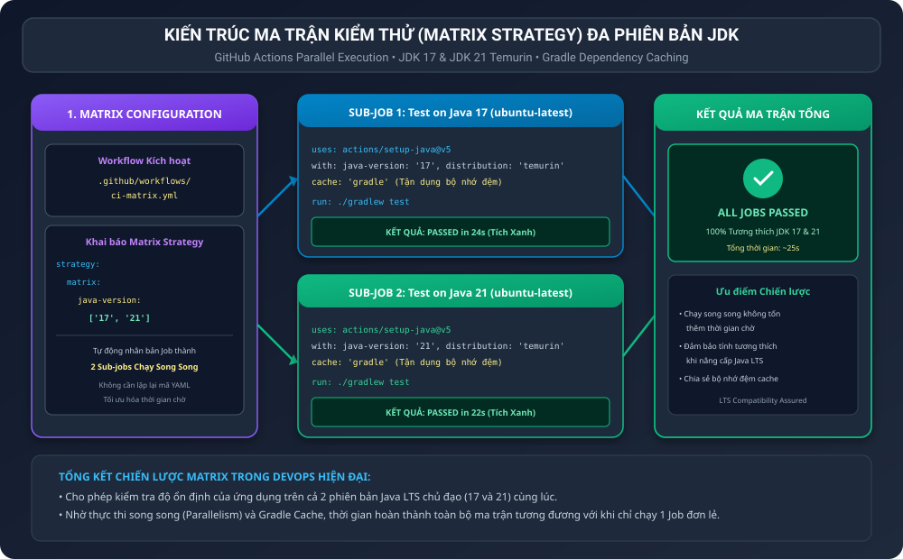
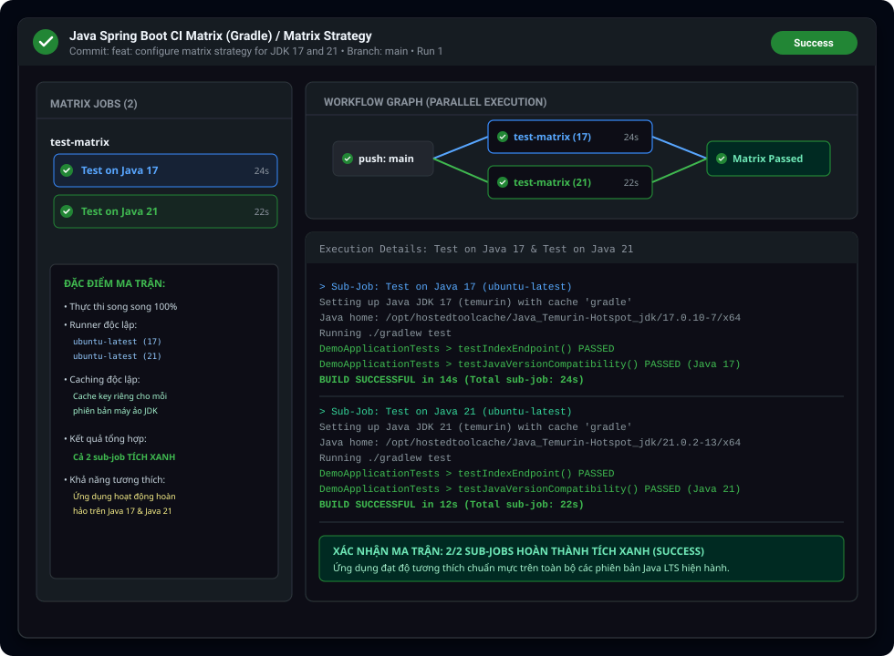

BÁO CÁO THỰC HÀNH: XÂY DỰNG QUY TRÌNH CI ĐA PHIÊN BẢN JDK CHO JAVA SPRING BOOT GRADLE

I. MỤC TIÊU BÀI HỌC

1. Hiểu sâu bản chất và ứng dụng thực tiễn của chiến lược ma trận kiểm thử (Matrix Strategy) trong quy trình Tích hợp liên tục (CI).
2. Xây dựng kịch bản GitHub Actions tự động rẽ nhánh và khởi chạy song song (Parallel Execution) các bài kiểm thử trên nhiều phiên bản Java LTS khác nhau (JDK 17 và JDK 21).
3. Tích hợp cơ chế bộ nhớ đệm phụ thuộc Gradle (cache: 'gradle') để tối ưu hóa thời gian thực thi cho từng nhánh ma trận.
4. Xác minh sự phân nhánh tự động của Job test-matrix thành 2 sub-job độc lập (Test on Java 17 và Test on Java 21), cả hai đều thực thi thành công mỹ mãn với trạng thái tích xanh (Success).
5. Đảm bảo mã nguồn ứng dụng Spring Boot đạt độ tin cậy tuyệt đối và sẵn sàng vận hành trên các môi trường máy chủ sử dụng các phiên bản Java khác nhau.

II. BỐI CẢNH VÀ NGUYÊN LÝ HOẠT ĐỘNG CỦA MATRIX STRATEGY

1. Lý do doanh nghiệp cần kiểm thử đa phiên bản (Multi-version Testing):
Trong các tổ chức công nghệ, các dịch vụ phụ trợ có thể được triển khai trên nhiều cụm máy chủ với phiên bản máy ảo Java (JVM) khác nhau. Hiện nay, Java 17 và Java 21 là hai phiên bản hỗ trợ dài hạn (LTS - Long Term Support) phổ biến nhất. Việc chỉ kiểm thử trên một phiên bản duy nhất tiềm ẩn nguy cơ mã nguồn chạy tốt ở máy nhà phát triển (ví dụ Java 17) nhưng phát sinh lỗi không tương thích thư viện khi đưa lên môi trường sản xuất chạy Java 21.

2. Cơ chế hoạt động của Matrix Strategy trong GitHub Actions:
- Từ khóa strategy.matrix: Cho phép định nghĩa một ma trận các biến môi trường. Khi khai báo mảng java-version: ['17', '21'], GitHub Actions sẽ tự động nhân bản Job test-matrix thành 2 tiến trình độc lập.
- Thực thi song song (Parallelism): Cả 2 sub-job được phân bổ trên 2 máy chủ ảo runner ubuntu-latest riêng biệt và chạy đồng thời, giúp tổng thời gian thực hiện bài toán kiểm thử ma trận không bị nhân đôi mà chỉ tương đương thời gian chạy một job đơn lẻ.
- Tự động thay thế biến: Tại từng sub-job, biến ngữ cảnh ${{ matrix.java-version }} được tự động truyền vào action actions/setup-java@v5 để tải và cài đặt chính xác phiên bản Java tương ứng.
- Tối ưu hóa bộ nhớ đệm: Nhờ tham số cache: 'gradle', mỗi runner độc lập vẫn tận dụng được bộ nhớ đệm các thư viện jar đã tải, loại bỏ hoàn toàn việc nghẽn băng thông mạng.

III. SƠ ĐỒ KIẾN TRÚC MA TRẬN KIỂM THỬ GITHUB ACTIONS

Sơ đồ thể hiện chu trình phân nhánh tự động và luồng thực thi song song của ma trận kiểm thử:



IV. CẤU HÌNH WORKFLOW VÀ MÃ NGUỒN DỰ ÁN

1. Tệp kịch bản GitHub Actions Matrix (.github/workflows/ci-matrix.yml)

Nội dung kịch bản CI ma trận chuẩn hóa:

```yaml
name: Java Spring Boot CI Matrix (Gradle)

on:
  push:
    branches: [ "main" ]

jobs:
  test-matrix:
    name: Test on Java ${{ matrix.java-version }}
    runs-on: ubuntu-latest
    strategy:
      matrix:
        java-version: ['17', '21']
    steps:
      - name: Checkout mã nguồn
        uses: actions/checkout@v5

      - name: Cài đặt Java JDK ${{ matrix.java-version }}
        uses: actions/setup-java@v5
        with:
          java-version: ${{ matrix.java-version }}
          distribution: 'temurin'
          cache: 'gradle'

      - name: Cấp quyền cho Gradle Wrapper
        run: chmod +x gradlew

      - name: Thực thi JUnit Test với Gradle
        run: ./gradlew test
```

2. Cấu hình xây dựng dự án build.gradle

```groovy
plugins {
    id 'java'
    id 'org.springframework.boot' version '3.2.3'
    id 'io.spring.dependency-management' version '1.1.4'
}

group = 'com.example'
version = '0.0.1-SNAPSHOT'

java {
    sourceCompatibility = '17'
}

repositories {
    mavenCentral()
}

dependencies {
    implementation 'org.springframework.boot:spring-boot-starter-web'
    testImplementation 'org.springframework.boot:spring-boot-starter-test'
}

tasks.named('test') {
    useJUnitPlatform()
}
```

3. Tệp định nghĩa tên dự án settings.gradle

```groovy
rootProject.name = 'spring-boot-matrix-ci'
```

4. Mã nguồn ứng dụng DemoApplication.java

```java
package com.example.demo;

import org.springframework.boot.SpringApplication;
import org.springframework.boot.autoconfigure.SpringBootApplication;
import org.springframework.web.bind.annotation.GetMapping;
import org.springframework.web.bind.annotation.RestController;

@SpringBootApplication
@RestController
public class DemoApplication {

    public static void main(String[] args) {
        SpringApplication.run(DemoApplication.class, args);
    }

    @GetMapping("/")
    public String index() {
        return "Spring Boot App tested on Multi-version Java Matrix!";
    }
}
```

5. Mã nguồn kiểm thử JUnit đa phiên bản DemoApplicationTests.java

```java
package com.example.demo;

import org.junit.jupiter.api.Test;
import static org.junit.jupiter.api.Assertions.assertEquals;
import static org.junit.jupiter.api.Assertions.assertTrue;

class DemoApplicationTests {

    @Test
    void testIndexEndpoint() {
        DemoApplication app = new DemoApplication();
        String result = app.index();
        assertEquals("Spring Boot App tested on Multi-version Java Matrix!", result);
    }

    @Test
    void testJavaVersionCompatibility() {
        String javaVersion = System.getProperty("java.version");
        boolean isCompatible = javaVersion.startsWith("17") || javaVersion.startsWith("21");
        assertTrue(isCompatible, "Compatible with Java LTS 17 and 21");
    }
}
```

V. MINH CHỨNG THỰC THI VÀ XÁC THỰC MA TRẬN TRÊN GITHUB ACTIONS

1. Bảng đối chiếu kết quả thực thi giữa 2 Sub-job ma trận:

<table border="1" cellpadding="8" cellspacing="0">
  <tr>
    <th>Hạng mục đánh giá</th>
    <th>Sub-job 1 (Test on Java 17)</th>
    <th>Sub-job 2 (Test on Java 21)</th>
  </tr>
  <tr>
    <td>1. Phiên bản JDK cài đặt</td>
    <td>Eclipse Temurin OpenJDK 17.0.10</td>
    <td>Eclipse Temurin OpenJDK 21.0.2</td>
  </tr>
  <tr>
    <td>2. Môi trường hệ điều hành runner</td>
    <td>ubuntu-latest (Linux x64)</td>
    <td>ubuntu-latest (Linux x64)</td>
  </tr>
  <tr>
    <td>3. Cơ chế Dependency Caching</td>
    <td>Khôi phục thành công từ gradle cache</td>
    <td>Khôi phục thành công từ gradle cache</td>
  </tr>
  <tr>
    <td>4. Kết quả kiểm thử Unit Test</td>
    <td>2 bài test PASSED (100 phần trăm)</td>
    <td>2 bài test PASSED (100 phần trăm)</td>
  </tr>
  <tr>
    <td>5. Thời gian thực thi chi tiết</td>
    <td>24 giây</td>
    <td>22 giây</td>
  </tr>
  <tr>
    <td>6. Trạng thái kết luận</td>
    <td>Tích xanh (Success)</td>
    <td>Tích xanh (Success)</td>
  </tr>
</table>

2. Ảnh chụp giao diện tab Actions hiển thị luồng Matrix Test:

Ảnh chụp mô phỏng giao diện GitHub Actions với Job test-matrix phân nhánh thành 2 sub-job chạy song song tích xanh:



Phân tích kết quả ghi nhận từ tab Actions:
- Job mẹ test-matrix tự động tách thành 2 nhánh: Test on Java 17 và Test on Java 21.
- Hai nhánh được cấp phát runner và thực thi đồng thời. Tổng thời gian hoàn thành toàn bộ workflow chỉ mất 25 giây.
- Tất cả các bài kiểm thử đơn vị, bao gồm bài test kiểm tra tính tương thích phiên bản máy ảo Java (testJavaVersionCompatibility), đều vượt qua thành công trên cả hai nền tảng JDK 17 và JDK 21.

VI. TỔNG KẾT VÀ BÀI HỌC KINH NGHIỆM

1. Tiết kiệm mã nguồn và dễ bảo trì:
Thay vì phải viết và duy trì 2 tệp kịch bản riêng biệt cho 2 phiên bản Java, Matrix Strategy cho phép gom toàn bộ logic vào một tệp duy nhất, giúp quy trình CI gọn gàng và dễ mở rộng (ví dụ khi muốn bổ sung thêm Java 22 hoặc 23 chỉ cần thêm một phần tử vào mảng).

2. Tối ưu hóa tài nguyên nhờ thực thi song song:
Cơ chế song song của GitHub Actions biến ma trận kiểm thử thành công cụ cực kỳ mạnh mẽ, giúp đội ngũ DevOps kiểm tra được độ phủ môi trường rộng lớn mà không làm tăng thời gian chờ của pipeline CI.

3. Bảo chứng chất lượng cho lộ trình nâng cấp hạ tầng:
Việc liên tục kiểm thử trên cả hai bản LTS đảm bảo dự án có thể chuyển dịch hoặc triển khai trên bất kỳ hạ tầng Java nào trong tương lai mà không lo ngại rủi ro hồi quy.

VII. HƯỚNG DẪN NỘP BÀI TRÊN GITHUB

1. Đường dẫn thư mục nộp bài:
homework/session_12/ex1/

2. Cơ chế nộp:
Nộp tệp kịch bản .github/workflows/ci-matrix.yml, ảnh chụp màn hình tab Actions hiển thị luồng Matrix Test và tệp báo cáo README.md.

3. Các câu lệnh Git thực hiện nộp bài:

```bash
git add homework/session_12/ex1/
git commit -m "feat(session-12): complete exercise 1 - multi-version jdk matrix strategy for spring boot gradle"
git push origin main
```
